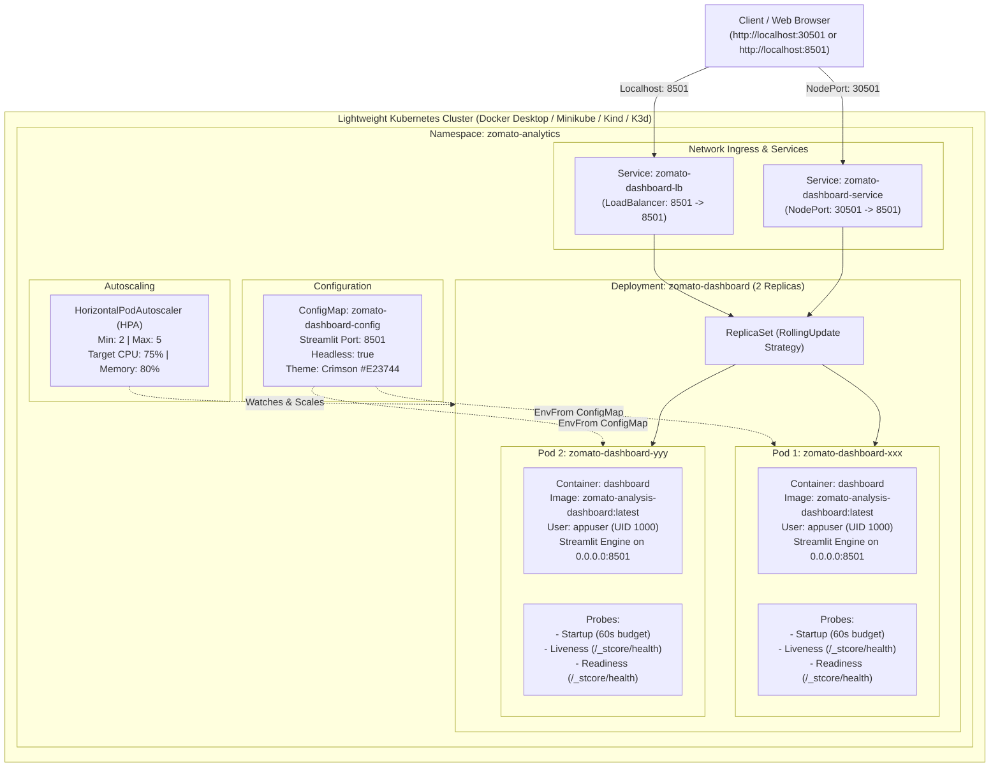

# Kubernetes Setup & Deployment Guide: Lightweight Cluster

This guide provides the complete production-grade **Kubernetes (K8s)** configuration for orchestrating the **Zomato Analytics Intelligence Dashboard** across lightweight local clusters (**Docker Desktop Kubernetes**, **Minikube**, **Kind**, or **K3d / K3s**).

---

## 1. Kubernetes Architecture for Zomato Analytics

While Docker runs individual containers, Kubernetes orchestrates multiple container replicas, handles rolling zero-downtime updates, balances incoming HTTP traffic, provides automated health monitoring (self-healing), and dynamically scales based on CPU/Memory load.



---

## 2. Directory Structure

All Kubernetes resources are organized cleanly inside the [`k8s/`](file:///d:/Akarsh/Mysore_pythonDocker/data_analysis/k8s) folder using **Kustomize**:

```
data_analysis/
├── k8s/
│   ├── namespace.yaml         # Isolated namespace (zomato-analytics)
│   ├── configmap.yaml         # Environment variables & Streamlit theme config
│   ├── deployment.yaml        # Pod specifications, replicas, probes, security
│   ├── service.yaml           # NodePort (30501) & LoadBalancer (8501) services
│   ├── hpa.yaml               # Horizontal Pod Autoscaler (2-5 replicas)
│   └── kustomization.yaml     # Kustomize manifest bundle
├── deploy-k8s.ps1             # 1-Click deployment script for Windows PowerShell
├── cleanup-k8s.ps1            # 1-Click teardown script for Windows PowerShell
├── deploy-k8s.sh              # 1-Click deployment script for Linux/WSL/macOS
├── cleanup-k8s.sh             # 1-Click teardown script for Linux/WSL/macOS
└── Dockerfile                 # Multi-stage/secure Dockerfile (python:3.12-slim)
```

---

## 3. Lightweight Cluster Options

You can run this Kubernetes setup on any of the following lightweight engines:

### Option A: Docker Desktop Kubernetes (Easiest on Windows)
1. Open **Docker Desktop**.
2. Click **Settings** (Gear Icon) -> **Kubernetes**.
3. Check **Enable Kubernetes** and click **Apply & Restart**.
4. Set context:
   ```powershell
   kubectl config use-context docker-desktop
   ```
*(Benefit: Images built locally via `docker build` are instantly accessible by pods without needing an image registry or manual loading!)*

### Option B: Minikube
```bash
# Start Minikube using Docker driver
minikube start --driver=docker --cpus=2 --memory=3072

# Point terminal to Minikube's Docker daemon (optional)
# Windows PowerShell:
& minikube -p minikube docker-env --shell powershell | Invoke-Expression
# Linux/WSL/macOS:
eval $(minikube docker-env)
```

### Option C: Kind (Kubernetes in Docker)
```bash
kind create cluster --name zomato-cluster
kubectl config use-context kind-zomato-cluster
```

### Option D: K3d / K3s (Rancher)
```bash
k3d cluster create zomato-cluster -p "8501:30501@agent:0"
kubectl config use-context k3d-zomato-cluster
```

---

## 4. Manifest Deep Dive

### 1. [`k8s/namespace.yaml`](file:///d:/Akarsh/Mysore_pythonDocker/data_analysis/k8s/namespace.yaml)
Isolates all components into the `zomato-analytics` namespace, preventing collisions with default cluster resources.

### 2. [`k8s/configmap.yaml`](file:///d:/Akarsh/Mysore_pythonDocker/data_analysis/k8s/configmap.yaml)
Decouples configuration from code:
* Sets headless execution: `STREAMLIT_SERVER_HEADLESS="true"`
* Binds to all network interfaces: `STREAMLIT_SERVER_ADDRESS="0.0.0.0"`
* Configures Zomato Crimson branding (`#E23744`) dynamically.

### 3. [`k8s/deployment.yaml`](file:///d:/Akarsh/Mysore_pythonDocker/data_analysis/k8s/deployment.yaml)
* **Replicas**: 2 pods running simultaneously for fault tolerance.
* **RollingUpdate**: Zero downtime deployments (`maxSurge: 1`, `maxUnavailable: 0`).
* **Non-Root Execution**: Runs as user `appuser` (UID `1000`), dropping all Linux capabilities for security compliance.
* **Triple Health Probes**:
  * `startupProbe`: Allows up to 60s for pandas to load [`zomato_clean_validated.csv`](file:///d:/Akarsh/Mysore_pythonDocker/data_analysis/zomato_clean_validated.csv) without failing prematurely.
  * `livenessProbe`: Verifies `/_stcore/health` every 15s to automatically restart frozen pods.
  * `readinessProbe`: Removes pod from the Service load balancer if it becomes temporarily busy.
* **Resource Quotas**:
  * Requests: 150m CPU, 384Mi RAM
  * Limits: 1000m CPU, 1024Mi RAM

### 4. [`k8s/service.yaml`](file:///d:/Akarsh/Mysore_pythonDocker/data_analysis/k8s/service.yaml)
* **NodePort Service (`zomato-dashboard-service`)**: Exposes port `30501` on every cluster node.
* **LoadBalancer Service (`zomato-dashboard-lb`)**: Exposes port `8501` directly on `localhost:8501` in Docker Desktop.

### 5. [`k8s/hpa.yaml`](file:///d:/Akarsh/Mysore_pythonDocker/data_analysis/k8s/hpa.yaml)
Monitors CPU (75% threshold) and Memory (80% threshold) and scales pods between **2 and 5 replicas**.

---

## 5. Step-by-Step Quickstart Guide

### Method 1: Using Automated PowerShell Script (Recommended for Windows)

Run the included automated deployment script:
```powershell
.\deploy-k8s.ps1
```

To automatically start port forwarding and open the browser:
```powershell
.\deploy-k8s.ps1 -PortForward
```

---

### Method 2: Manual Step-by-Step Deployment

#### Step 1: Build the Container Image
```powershell
docker build -t zomato-analysis-dashboard:latest .
```

#### Step 2: (Minikube / Kind Only) Load Image into Cluster
* **If using Docker Desktop**: Skip this step.
* **If using Minikube**:
  ```powershell
  minikube image load zomato-analysis-dashboard:latest
  ```
* **If using Kind**:
  ```powershell
  kind load docker-image zomato-analysis-dashboard:latest --name zomato-cluster
  ```

#### Step 3: Deploy All Resources via Kustomize
```powershell
kubectl apply -k k8s
```

#### Step 4: Monitor Rollout Status
```powershell
kubectl rollout status deployment/zomato-dashboard -n zomato-analytics --timeout=90s
```

#### Step 5: Check Pods and Services
```powershell
kubectl get pods -n zomato-analytics -o wide
kubectl get svc -n zomato-analytics
```

---

## 6. Accessing the Application

Depending on your local Kubernetes setup:

| Cluster Type | URL | Method |
| :--- | :--- | :--- |
| **Docker Desktop** | `http://localhost:8501` | LoadBalancer Service |
| **Docker Desktop / Any** | `http://localhost:30501` | NodePort Service |
| **Minikube** | Run `minikube service zomato-dashboard-service -n zomato-analytics` | Minikube Tunnel |
| **Universal Port-Forward** | `http://localhost:8501` | Run `kubectl port-forward svc/zomato-dashboard-service 8501:8501 -n zomato-analytics` |

---

## 7. Useful Day-2 Kubernetes Operations

### Stream Pod Logs in Real-Time
```powershell
kubectl logs -f -l app.kubernetes.io/name=zomato-dashboard -n zomato-analytics --max-log-requests=4
```

### Inspect Detailed Pod Health & Events
```powershell
kubectl describe pods -l app.kubernetes.io/name=zomato-dashboard -n zomato-analytics
```

### Test Self-Healing (Kill a Pod)
Delete one of the running pods and watch Kubernetes immediately spawn a replacement to maintain desired replica count:
```powershell
# Get active pod names
kubectl get pods -n zomato-analytics

# Delete one pod
kubectl delete pod <POD_NAME> -n zomato-analytics

# Watch replacement pod instantly spawn:
kubectl get pods -n zomato-analytics -w
```

### Manual Scaling
Scale the deployment from 2 to 4 pods on demand:
```powershell
kubectl scale deployment zomato-dashboard --replicas=4 -n zomato-analytics
```

### Zero-Downtime Rolling Restart
Restart pods sequentially without dropping user traffic:
```powershell
kubectl rollout restart deployment/zomato-dashboard -n zomato-analytics
kubectl rollout status deployment/zomato-dashboard -n zomato-analytics
```

### Teardown & Clean Up
Delete all resources and namespace cleanly:
```powershell
kubectl delete -k k8s
# Or using the cleanup script:
.\cleanup-k8s.ps1
```
