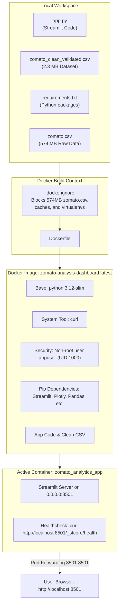

# Docker Guide & Containerization Manual: Zomato Analytics Project

This document provides a comprehensive explanation of **Docker**, containerization principles, and the specific Docker setup created for the **Zomato Bangalore Restaurant Intelligence Dashboard** in [`app.py`](file:///d:/Akarsh/Mysore_pythonDocker/data_analysis/app.py).

---

## 1. What is Docker?

**Docker** is an open-source platform that automates the deployment, scaling, and management of applications inside lightweight, portable, and self-sufficient environments called **containers**.

### The Core Problem Docker Solves: *"It works on my machine!"*
In traditional development, running an application on a colleague's laptop or a production server often fails due to:
* Different operating systems (Windows vs macOS vs Linux)
* Mismatched Python versions (e.g., Python 3.10 vs Python 3.12)
* Missing system-level packages (e.g., `curl`, C-compiler libraries)
* Conflicting Python packages installed globally

Docker bundles the **application code**, **runtime** (Python 3.12), **libraries** ([`requirements.txt`](file:///d:/Akarsh/Mysore_pythonDocker/data_analysis/requirements.txt)), **system tools**, and **configuration settings** into a single immutable artifact.

```
+-----------------------------------------------------------------+
|                       Host Operating System                     |
|  +-----------------------------------------------------------+  |
|  |                       Docker Engine                       |  |
|  |  +-----------------------+     +-----------------------+  |  |
|  |  |      Container 1      |     |      Container 2      |  |  |
|  |  |  Streamlit App        |     |  Database / Backend   |  |  |
|  |  |  Python 3.12 + deps   |     |  Isolated environment |  |  |
|  |  +-----------------------+     +-----------------------+  |  |
|  +-----------------------------------------------------------+  |
+-----------------------------------------------------------------+
```

### Containers vs. Virtual Machines (VMs)
* **Virtual Machines (VMs):** Each VM packages a full Guest OS (several gigabytes), requiring hardware virtualization via a Hypervisor. VMs are heavy and slow to boot.
* **Docker Containers:** Share the host operating system's kernel and isolate only the user-space processes. Containers boot in seconds and consume a fraction of the RAM and disk space.

---

## 2. Fundamental Docker Concepts

| Concept | Definition | Analogy |
| :--- | :--- | :--- |
| **Dockerfile** | A plain-text script containing step-by-step instructions to build an image. | The **Recipe** |
| **Docker Image** | A read-only, multi-layered template built from the Dockerfile. | The **Cake Batter / Blueprint** |
| **Container** | A runnable, isolated instance of an image with a thin read/write layer. | The **Baked Cake** |
| **Docker Daemon** | The background service (`dockerd`) managing containers, images, and networks. | The **Kitchen Engine** |
| **Docker CLI** | The command-line tool (`docker`) used to talk to the Docker daemon. | The **Chef's Orders** |
| **Registry** | A repository for storing and sharing Docker images (e.g., Docker Hub). | The **Supermarket** |

---

## 3. Project Architecture & Container Flow



---

## 4. Deep Dive: Project Configuration Files

### A. [`Dockerfile`](file:///d:/Akarsh/Mysore_pythonDocker/data_analysis/Dockerfile) Breakdown

```dockerfile
# 1. Base Image: Use minimal Debian-based Python 3.12
FROM python:3.12-slim

# 2. Environment Variables:
# - PYTHONDONTWRITEBYTECODE: Avoid writing .pyc files inside container
# - PYTHONUNBUFFERED: Stream logs directly to stdout/stderr in real time
# - STREAMLIT flags: Headless mode, bind to all network interfaces (0.0.0.0)
ENV PYTHONDONTWRITEBYTECODE=1 \
    PYTHONUNBUFFERED=1 \
    STREAMLIT_SERVER_PORT=8501 \
    STREAMLIT_SERVER_ADDRESS=0.0.0.0 \
    STREAMLIT_SERVER_HEADLESS=true \
    STREAMLIT_BROWSER_GATHER_USAGE_STATS=false

# 3. System Tools: Install curl for container health monitoring
RUN apt-get update && apt-get install -y --no-install-recommends \
    curl \
    && rm -rf /var/lib/apt/lists/*

# 4. Security Principle of Least Privilege:
# Running as 'root' inside a container is a security risk.
# Create a dedicated non-root user (appuser).
RUN useradd -m -u 1000 appuser

WORKDIR /app

# 5. Docker Layer Caching Optimization:
# Copy ONLY requirements.txt first. If app.py changes but requirements.txt
# does not, Docker reuses the cached layer, skipping the slow pip install step!
COPY requirements.txt .
RUN pip install --no-cache-dir --upgrade pip && \
    pip install --no-cache-dir -r requirements.txt

# 6. Copy Application Files & Transfer Ownership
COPY . .
RUN chown -R appuser:appuser /app

# 7. Switch to Non-Root User
USER appuser

# 8. Document Port Exposure
EXPOSE 8501

# 9. Automated Health Check:
# Periodically probes Streamlit's internal health endpoint.
HEALTHCHECK --interval=30s --timeout=5s --start-period=10s --retries=3 \
    CMD curl --fail http://localhost:8501/_stcore/health || exit 1

# 10. Container Entrypoint
ENTRYPOINT ["streamlit", "run", "app.py"]
```

---

### B. [`.dockerignore`](file:///d:/Akarsh/Mysore_pythonDocker/data_analysis/.dockerignore) Breakdown

When you run `docker build .`, the Docker CLI sends the current directory (the **build context**) to the Docker daemon.

#### Why `.dockerignore` is Critical Here:
1. **The 574 MB Raw Data Leak:**
   * In your workspace, [`zomato.csv`](file:///d:/Akarsh/Mysore_pythonDocker/data_analysis/zomato.csv) is **574 MB**, while the production-ready dataset [`zomato_clean_validated.csv`](file:///d:/Akarsh/Mysore_pythonDocker/data_analysis/zomato_clean_validated.csv) is only **2.3 MB**.
   * Without [`.dockerignore`](file:///d:/Akarsh/Mysore_pythonDocker/data_analysis/.dockerignore), Docker would upload $>570\text{ MB}$ to the daemon on every single build, inflating build times and ballooning the final image size.
2. **Preventing Cache Poisoning:**
   * Local virtual environments (`.venv/`, `venv/`) and bytecode (`__pycache__/`) compiled on Windows can break or conflict when copied into a Linux container.

Included exclusions:
```dockerignore
zomato.csv           # 574MB raw unvalidated data
.git/                # Version control history
__pycache__/         # Python compiled bytecode
*.py[cod]            # Python cached objects
.venv/ venv/         # Host-specific virtual environments
.vscode/ .idea/      # IDE configurations
*.log                # Temporary logs
```

---

### C. [`docker-compose.yml`](file:///d:/Akarsh/Mysore_pythonDocker/data_analysis/docker-compose.yml) Breakdown

Docker Compose is a tool for defining and running multi-container Docker applications via declarative YAML. Even for a single container, it saves you from remembering long command-line flags:

```yaml
services:
  zomato-dashboard:
    build:
      context: .
      dockerfile: Dockerfile
    image: zomato-analysis-dashboard:latest
    container_name: zomato_analytics_app
    ports:
      - "8501:8501"      # Maps host port 8501 to container port 8501
    restart: unless-stopped
    environment:
      - STREAMLIT_SERVER_PORT=8501
      - STREAMLIT_SERVER_ADDRESS=0.0.0.0
```

---

## 5. Practical Command Reference

### Prerequisite
Ensure **Docker Desktop** is open and the Docker Engine status icon is green.

### Using Docker Compose (Recommended)

| Action | Command | Description |
| :--- | :--- | :--- |
| **Build & Run (Detached)** | `docker compose up --build -d` | Builds the image and starts the container in the background. |
| **View Live Logs** | `docker compose logs -f` | Streams application stdout and Streamlit server logs. |
| **Check Status** | `docker compose ps` | Displays running status, port mappings, and health status. |
| **Stop Dashboard** | `docker compose down` | Stops and safely removes the container and network. |
| **Restart Dashboard** | `docker compose restart` | Restarts the running container without rebuilding. |

---

### Using Standard Docker CLI

#### 1. Build the Image
```powershell
docker build -t zomato-analysis-dashboard:latest .
```
* `-t zomato-analysis-dashboard:latest`: Tags the resulting image with a human-readable name and version.
* `.`: Path to the build context (current directory).

#### 2. Run the Container
```powershell
docker run -d --name zomato_analytics_app -p 8501:8501 zomato-analysis-dashboard:latest
```
* `-d`: Run in detached mode (background).
* `--name zomato_analytics_app`: Assigns an explicit name instead of a random UUID.
* `-p 8501:8501`: Maps host port `8501` to container port `8501`.

#### 3. Monitor and Inspect
```powershell
# View running containers and healthcheck status
docker ps

# Stream logs in real time
docker logs -f zomato_analytics_app

# Check live CPU, Memory, and Network usage
docker stats zomato_analytics_app
```

#### 4. Open an Interactive Shell inside the Container
```powershell
docker exec -it zomato_analytics_app /bin/bash
```
* Useful for inspecting the filesystem, verifying file paths, or checking permissions as `appuser`.

#### 5. Stop and Clean Up
```powershell
# Stop the running container
docker stop zomato_analytics_app

# Remove the container
docker rm zomato_analytics_app

# Remove the built image (when cleaning up disk space)
docker rmi zomato-analysis-dashboard:latest
```

---

## 6. Common Issues & Troubleshooting

### 1. `Cannot connect to the Docker daemon`
* **Cause:** Docker Desktop is not running or hasn't finished initializing.
* **Solution:** Launch **Docker Desktop** from the Start Menu and wait until the whale icon in the taskbar indicates that the engine is active.

### 2. `Bind for 0.0.0.0:8501 failed: port is already allocated`
* **Cause:** Another process (or a locally running Streamlit instance) is occupying port 8501.
* **Solution:**
  * Find and terminate the process using port 8501:
    ```powershell
    Get-NetTCPConnection -LocalPort 8501 | Select-Object OwningProcess
    ```
  * Or map to a different host port (e.g. `8502:8501`):
    ```powershell
    docker run -d -p 8502:8501 --name zomato_analytics_app zomato-analysis-dashboard:latest
    ```
    Then browse to `http://localhost:8502`.

### 3. Container Status shows `(unhealthy)`
* **Cause:** The `curl` command inside the health check failed to get a 200 response from `http://localhost:8501/_stcore/health` within the timeout window.
* **Solution:** Inspect the container logs to verify if an error occurred during Python startup or data loading:
  ```powershell
  docker logs zomato_analytics_app
  ```
